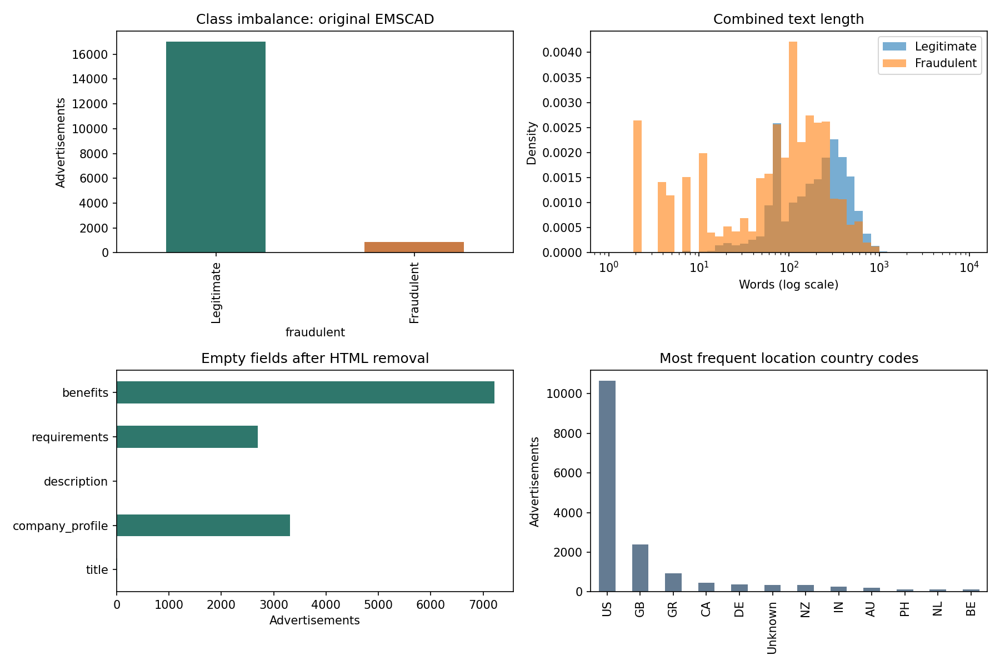
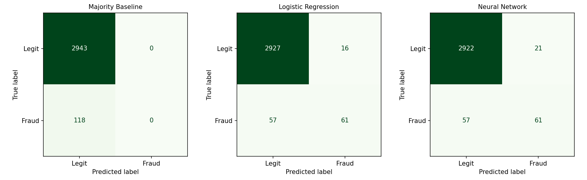
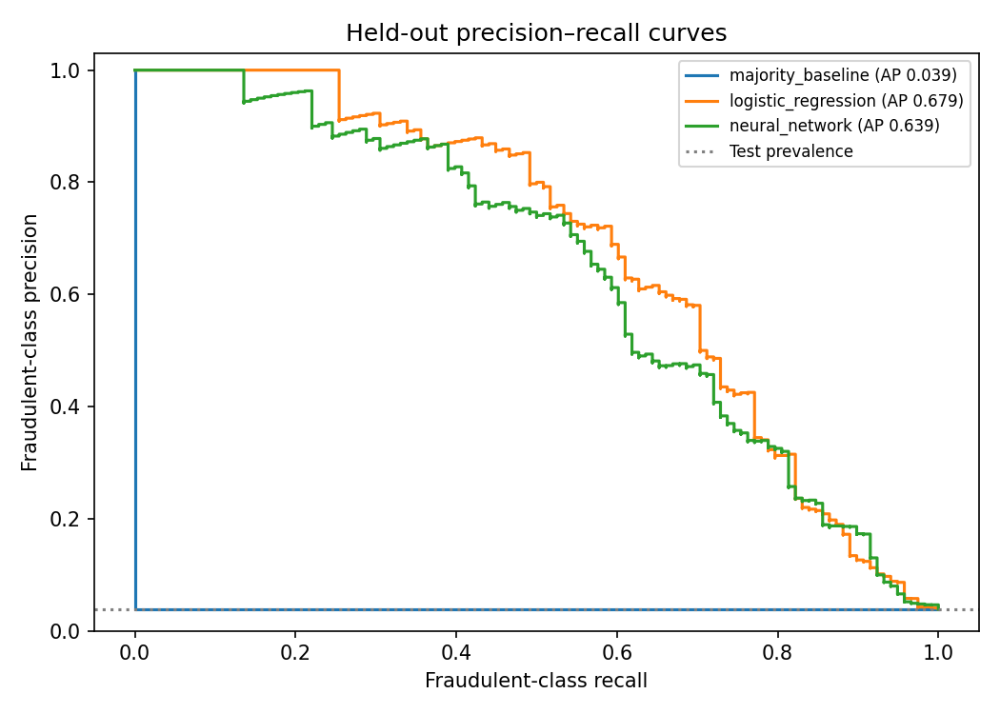
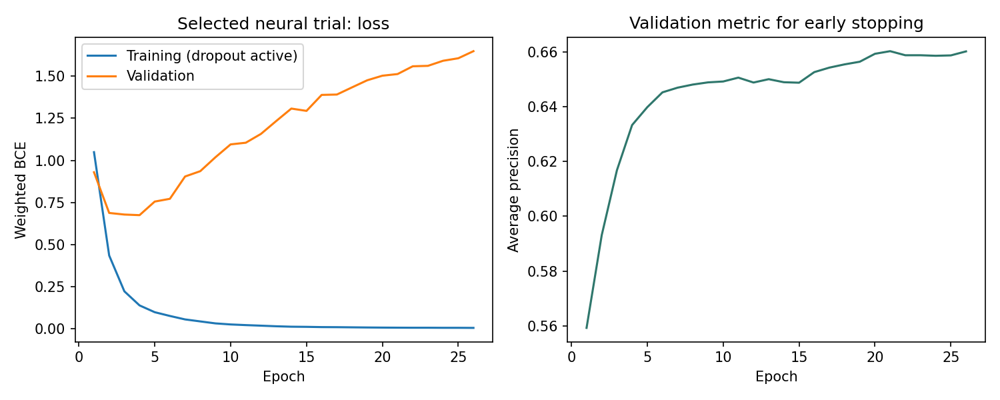
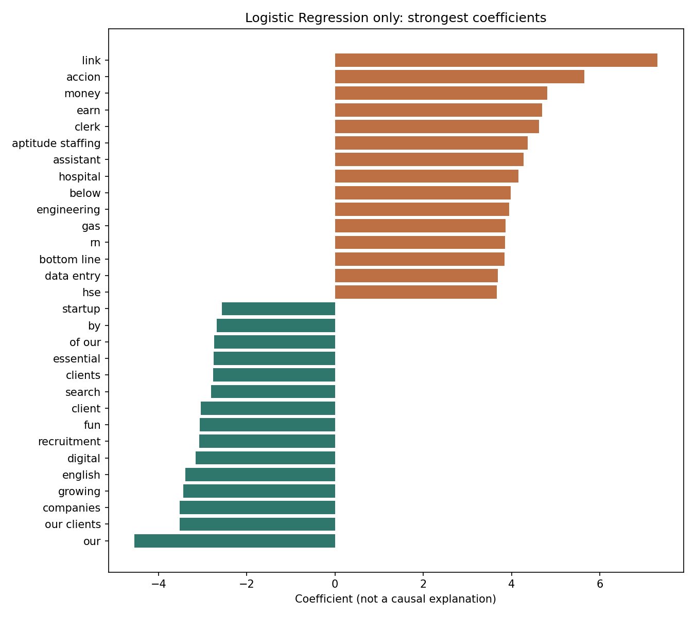

# VacancyLens: methodology and results

## Problem and intended use

Binary text classification of English job advertisements: 0 legitimate, 1 fraudulent. Recruitment scams can cost applicants money and personal information. The goal is an interpretable, reproducible university experiment with a working local screening interface. A positive prediction warrants investigation; a negative prediction does not verify the employer. We measure fraudulent-class precision, recall, F1, average precision (AP), and ROC-AUC against a majority baseline. Accuracy is supplementary.

## Dataset and provenance

We used the actual Employment Scam Aegean Dataset (EMSCAD), distributed by Shivam Bansal on [Kaggle](https://www.kaggle.com/datasets/shivamb/real-or-fake-fake-jobposting-prediction). The official Kaggle API archive downloaded successfully without credentials; its CSV matched the previously supplied local CSV byte for byte. It has **17,880 rows and 18 columns**, with **17,014 legitimate (95.16%)** and **866 fraudulent (4.84%)** examples. SHA-256:

`59253295129d8b6a27607f9904f7d4ddf4dbb0ee35e079c7eb51b58b5e62bf60`

The API metadata declares **CC0: Public Domain**. This describes the Kaggle distribution; it is not an independent legal determination of rights in every advertisement. The original authors describe a public research release. Provenance, timestamp, file size, and source metadata are recorded in `data/provenance.json` and `data/kaggle_metadata.json`. Raw data remain outside Git.

[Vidros, Kolias, Kambourakis, and Akoglu (2017), *Automatic Detection of Online Recruitment Frauds: Characteristics, Methods, and a Public Dataset*, Future Internet 9(1):6](https://doi.org/10.3390/fi9010006) describes Workable advertisements collected in 2012–2014 and expert annotations. Platform origin is not evidence of legitimacy: both classes occur within this source. We use its intended English benchmark scope; we did not independently language-label each row or validate performance in another language.

## Exploratory analysis and consequences

`reports/eda.json` contains the full missingness and length summaries. The class imbalance motivates weighting and precision–recall evaluation. The selected fields have 13 empty cleaned titles, 3,308 empty company profiles, 2 empty descriptions, 2,698 empty requirements, and 7,220 empty benefits. Optional fields are empty strings, with no imputation learned from the entire dataset. Rare rows without descriptions retain information in other fields during training; the web form requires a readable description for a useful new submission.

Combined text has median 355 words for legitimate advertisements and 224.5 for fraudulent ones (means 379.5 and 282.3). Frauds are shorter on average, but the distributions overlap substantially; length is not a decision rule. Missing-profile rows have a 17.74% fraud rate versus 1.91% when a profile exists. This association can reflect platform/annotation practices and is not causal. Inputs use actual text, not a hard-coded profile rule. US locations account for 10,656 rows (59.6%), followed by GB 2,384 and GR 940, limiting geographic representativeness. The log length axis shows the long tail; we retain legitimate long-text outliers, use sublinear TF, and impose a shared 60,000-character processing limit. No synthetic examples or SMOTE are used.

There are 281 exact full-row duplicates after excluding job IDs, and **2,008 excess duplicates under normalized model-input text**. Normalization includes HTML stripping, whitespace normalization, and case folding for identity checks. No conflicting exact normalized-text label groups were found (the quarantine output is still saved). The implementation quarantines every row of any conflicting group before removing same-label duplicates. No rows have completely empty combined text.

## Preprocessing and evaluation design

Training and inference import `shared/text.py` and `shared/model.py`. Inputs are title, company profile, description, requirements, and benefits, in that order. Missing/non-string values become empty strings. HTML tags, script/style content, and irrelevant whitespace are removed; punctuation and ordinary language are retained. IDs, labels, locations, logos, salary, and target-derived metadata never enter features. The vectorizer performs lowercasing, Unicode accent stripping, word unigram/bigram tokenization, sublinear TF, and L2 normalization. Its vocabulary and IDF are learned on training alone: at most 12,000 features, minimum document frequency 2, maximum .98.

After exact deduplication **15,872 advertisements** remain. Groups connect exact cleaned company profiles of at least 150 characters (an imperfect employer proxy), exact descriptions of at least 100 characters, and verified near-duplicates. Near-duplicate candidates use **64-permutation MinHash LSH**, candidate threshold .75; candidates are verified using exact **five-word-shingle Jaccard similarity >= .85**. We detected **12,203 qualifying pairs**; none cross partitions. Short texts with fewer than 15 shingles are excluded from approximate search. Candidate discovery is approximate: the audit cannot prove every paraphrase or near-duplicate was found. Reused generic profiles may over-group employers, and changed/missing profiles may fail to identify the same employer.

There are 4,795 connected groups, the largest containing 495 unique ads. `StratifiedGroupKFold(n_splits=5, shuffle=True, random_state=42)` assigns fold 0 to test, fold 1 to validation, and folds 2–4 to training. Groups are preserved even when exact stratification is impossible. Actual sizes differ from nominal 60/20/20:

| Partition | Legitimate | Fraudulent | Total | Fraud rate |
|---|---:|---:|---:|---:|
| Train | 9,775 | 474 | 10,249 | 4.62% |
| Validation | 2,441 | 121 | 2,562 | 4.72% |
| Test | 2,943 | 118 | 3,061 | 3.85% |

All usable data participate in this final experiment. Test data are never used to fit preprocessing, choose hyperparameters, stop training, or choose thresholds. There is no reliable timestamp for a temporal split. Group boundaries and row indices are saved in `reports/splits.csv`. This is a more demanding evaluation than a naive random row split; it is still a single historical holdout, not a universal estimate. We retain the selected training-only fits for inference instead of refitting across validation/test and invalidating the evaluation.

## Models, tuning, and training

All models use the same split and feature matrix. Random seeds for Python, NumPy, and PyTorch are 42; deterministic PyTorch algorithms and two CPU threads are used. Minibatches alone are densified; the entire sparse dataset is never converted to a dense matrix.

- **Majority baseline:** scikit-learn `DummyClassifier(strategy='most_frequent')`, fitted on training labels.
- **Logistic Regression:** TF-IDF plus L2-regularized Logistic Regression, balanced training class weights, liblinear, at most 500 iterations. A fixed practical grid C = 0.5, 2, 8 yields validation AP 0.6155, 0.6468, 0.6595; **C = 8** is selected.
- **PyTorch MLP:** 12,000 inputs → linear hidden layer → ReLU → dropout → linear scalar logit. `BCEWithLogitsLoss`, positive-class weight **9775 / 474 = 20.6224**, AdamW, weight decay .0001, batch size 128, limit 30 epochs. Two trials: hidden 64/dropout .3/lr .003 and hidden 128/dropout .5/lr .001. Validation AP is 0.6533 and **0.6603**, respectively. The latter is selected, with 1,536,257 parameters. Early stopping monitors validation AP with patience 5 and minimum improvement .0001; it restores **epoch 21**, stopping after epoch 26. The first trial restores epoch 8 and stops after epoch 13. The limited grid is practical, not an exhaustive optimization claim.

Exact search results and per-epoch histories are in `reports/search.json`. Both trained models choose the score threshold maximizing fraudulent-class F1 **on validation only**, with lowest-threshold tie-breaking: LR **0.697014**, neural **0.759135**. This treats precision and recall equally, rather than assigning an unsupported real-world cost. A deployment with known costs could choose a different threshold on new validation data. Ranking hyperparameter selection uses AP, while the operating point uses F1. The neural network is the UI default to demonstrate the required neural component; Logistic Regression is also selectable and is stronger on held-out metrics.

## Final held-out results

PR-AUC here means scikit-learn **average precision**, the non-interpolated sum of precision weighted by recall increments. It is not trapezoidal integration. ROC-AUC uses continuous scores, not thresholded labels.

| Model | Accuracy | Fraud precision | Fraud recall | Fraud F1 | AP | ROC-AUC |
|---|---:|---:|---:|---:|---:|---:|
| Majority | .9615 | .0000 | .0000 | .0000 | .0385 | .5000 |
| Logistic Regression | .9762 | .7922 | .5169 | .6256 | .6786 | .9267 |
| Neural network | .9745 | .7439 | .5169 | .6100 | .6389 | .9256 |

Both learned models find 61 frauds and miss 57. LR makes 16 false alarms; the neural network makes 21. The majority baseline gets 96.1% accuracy while detecting **zero** frauds, directly illustrating why accuracy alone is misleading. Class-weighted sigmoid and LR scores have **not been calibrated** and must not be called verified probabilities. A high score is a model output, not evidence that a specific employer committed fraud.

The matrices use true classes as rows and predicted classes as columns, with class 0 first. The PR curves show performance across thresholds; the dotted line is test prevalence, not a model reliability guarantee. With only 118 positive test examples, a few changed predictions materially affect recall. No confidence intervals, repeated-seed estimates, or external/temporal validation are claimed.

## Learning behavior and generalization

Training loss falls from 1.0487 to 0.0032, while validation loss is lowest near epoch 4 and then rises. Validation ranking AP improves more slowly, reaching the selected checkpoint at epoch 21. This is evidence of overfitting and increasingly extreme errors, even though ranking still improves. Early stopping optimizes AP rather than loss, so it does not select the lowest-loss checkpoint. Dropout is active for training loss and disabled for validation; these curves therefore are not perfectly matched estimates. Logistic Regression performs better on the held-out set despite nearly equal validation AP, consistent with the larger model learning details that generalize poorly. The baseline strongly underfits because it ignores the text. There is no evidence that making the network larger would improve the application. No test-driven retuning was performed.

## Interpretation and error analysis

`reports/logistic_coefficients.csv` contains the most negative and positive coefficients **of Logistic Regression only**. Terms such as “link”, “accion”, and “money” have positive coefficients; “our”, “our clients”, and “companies” have negative coefficients in this fitted vocabulary. These are associations conditional on TF-IDF and regularization, not universal scam indicators or causal findings. The strong employer/industry-specific terms are evidence of potential dataset shortcuts. Correlated unigrams/bigrams share weights. This global coefficient plot does not explain a neural network prediction. No neural attribution method is claimed or displayed.

`reports/error_examples.json` records the first three errors and successes in original row order per class/model, rather than cherry-picking examples. These are real held-out examples, with dataset job IDs for inspection. IDs are never fed to the classifier. Examples for the neural model:

| Type | Job ID | Original title | Score |
|---|---:|---|---:|
| False positive | 25 | Customer Service | .986 |
| False positive | 779 | GREAT Bookkeeper Position Available | .981 |
| False negative | 358 | Financing Auto(car) sales | .406 |
| False negative | 1996 | Customer service/ Data Entry | .001 |
| True positive | 585 | Quality Improvement Manager | .828 |
| True negative | 5 | Bill Review Manager | <.001 |

Legitimate administrative/bookkeeping roles receive high scores, suggesting that broad role-related language can create false alarms. A fraudulent customer service listing receives a very low score despite ordinary professional wording; text alone cannot authenticate the company. These are qualitative observations, not proven explanations of the neural decision. Ground truth here is the historical dataset annotation, not an independent investigation of those named entities. Do not republish error excerpts as accusations about present-day businesses.

## Scope, privacy, and next steps

The sample reflects one historical platform, uneven geography, annotation procedures, and English-language conventions. Current scammers and legitimate recruiting practices can differ substantially. Similarity grouping reduces measured leakage but does not eliminate all related employers or paraphrases. Missing profiles and genre-specific tokens can encode sampling bias. The model misses almost half the frauds in the chosen holdout; it must support human review rather than determine trust or reject applicants/employers automatically.

The local app does not store submitted text, does not log request bodies, and uses no external classification service. Existing dataset ads can contain company/contact details; restrict redistribution of excerpts and never submit private applicant information. Default logs contain paths/status, not vacancy bodies. Next steps: independent recent and geographically diverse labeled data; time/employer-aware external validation; confidence intervals across groups/seeds; calibration measured on separate validation data; cost-sensitive threshold design with stakeholders; investigate false negatives and shortcut features. Those changes require fresh validation and a new untouched test set.

## Reproducibility and submission

See `README.md` for exact setup, download, training, evaluation, testing, and startup commands. Artifacts include state_dict, fitted vectorizer, LR and baseline estimators, configuration, thresholds, provenance, metrics, exact environment versions, and SHA-256 manifest. Artifacts are loaded once in FastAPI lifespan. PyTorch uses CPU, eval mode, and inference mode. Dependencies are isolated in `.venv` and locked in `requirements.lock.txt`; the frontend uses `package-lock.json`. The recorded results come from actual full-data training, not an API or synthetic substitute.

The supplied course PDF is mapped in `reports/COURSE_REQUIREMENTS.md`. A slide deck and defense notes accompany this report. The written and software deliverables support the presentation; students must review them, state their actual contributions, and be able to explain the work themselves.

## Citations and AI disclosure

- Dataset and original research: Kaggle distribution and Vidros et al. (2017), linked above.
- [scikit-learn documentation](https://scikit-learn.org/stable/) for TF-IDF, Logistic Regression, grouping, and metrics; [PyTorch documentation](https://pytorch.org/docs/stable/) for modules, loss, optimizer, and inference.
- [datasketch documentation](https://ekzhu.com/datasketch/) for MinHash/LSH; [FastAPI](https://fastapi.tiangolo.com/), [Pydantic](https://docs.pydantic.dev/), [React](https://react.dev/), [Vite](https://vite.dev/), and [Playwright](https://playwright.dev/) for application/testing APIs.
- No pretrained weights or third-party model implementation were imported. The MLP, pipeline, web app, reports, and scripts were written for this project using these libraries; the initial frontend contained a standard Vite starter.
- **AI assistance:** OpenAI Codex assisted with implementation, experiment execution, debugging, interface design, documentation, and presentation materials. The scores and examples were computed from the real dataset by executable code. Students must verify the materials and disclose assistance in their submitted slides; AI-generated prose does not replace understanding or individual contribution disclosure.
